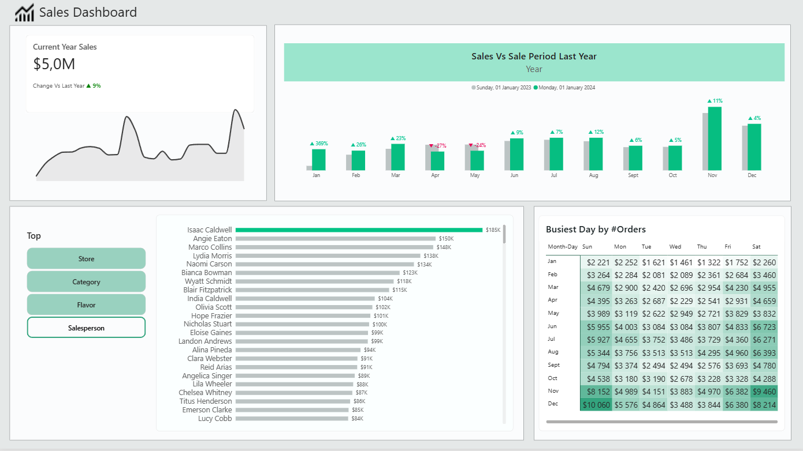
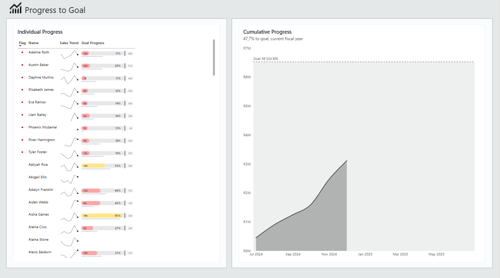

# Sales Performance Dashboard

An interactive Power BI dashboard that tracks sales performance and each salesperson's progress toward their goal. It is built with DAX measures, dynamic dimension switching and custom SVG visuals.

## Dashboard Walkthrough

https://github.com/user-attachments/assets/b8893a2d-0772-436d-a63e-8baebde22891

## Business Question
How are sales performing over time, who is driving them, and which salespeople are on track to hit their goals?

## Data
- **Source:** Sample dataset provided in Christine Payton's Power BI course on Udemy
- **Tables:** Sales, Employees, Sales Goals, Date
- **Note:** This project uses course sample data only. It contains no real company information.

## Dashboard Pages

### 1. Sales
- **Current Year Sales** card for a quick headline number
- **Sales by Month** line chart and column chart for trends
- **Sales by Person** bar chart that switches dimension using a field parameter slicer
- **Day of Week vs Month** matrix showing sales counts

### 2. Progress to Goal
- Table showing each salesperson's progress toward their goal with a custom **SVG bullet chart**
- Color-coded progress: green (goal met), yellow (50% or more), red (below 50%)
- Red dot indicator for people at or below 20% of goal
- Sales trend sparklines
- **Cumulative sales** area chart

## Key Techniques
- **Field parameters** so users can change the dimension on the bar chart
- Time intelligence measures, including current year and same period last year
- Sparklines and conditional formatting
- Whole-number rounding in the SVG measure to avoid decimal-separator problems on regional settings that use a comma

## Key Insights
- **Sales are up 9% year over year**, reaching **$5.0M** for the current year, with **November 2024** the strongest month at about **$880K**.
- **Growth was strong in most months** (Jun to Dec all up 4% to 12%), but **April and May were down about 27% and 24%** compared with the same months last year, which is worth investigating.
- **Paris and Miami lead on sales at about $1.14M each**, while **Houston is lowest at about $0.53M**. That is roughly half the top stores' sales.
- **Isaac Caldwell is the top salesperson at about $185K**, followed by Angie Eaton at about $150K.
- **Weekends in Nov and Dec are the busiest**, peaking on Sundays in December at over $10K.
- **Several salespeople are well behind their individual goals**, with many below 20% in the period shown.
- **Next step:** investigate the April/May dip and why several salespeople are far behind their goals.
## Files
- `Sales_Dashboard.pbix`: the Power BI file (open in Power BI Desktop)
- `images/`: dashboard screenshots

## Tools
Power BI Desktop, DAX, Power Query

## Credits
Dataset and project brief from Christine Payton's Udemy course. I customized the dashboard, including the SVG bullet chart and the Red Dot indicator, with my own modifications to the DAX measures.

## Author
Payton | www.linkedin.com/in/payton-adams-2a1415386
